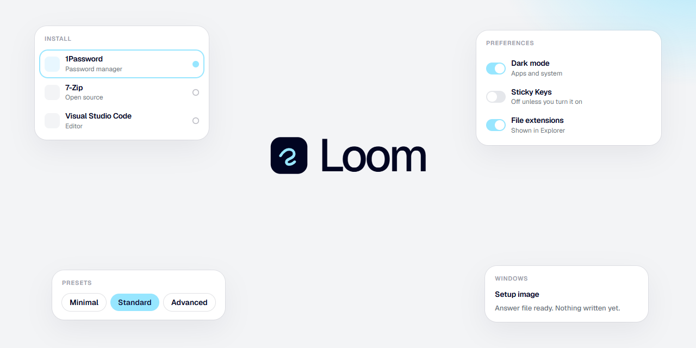

<div align="center">



# Loom

A Windows desktop utility for the programs you install, the system you tune,<br/>
and the setup image you keep.

**Version 1.0** · Built with [Tauri](https://tauri.app) and [React](https://react.dev)

[](package.json)
[](LICENSE)
[](https://github.com/TomFleuren/Loom/actions/workflows/ci.yml)
[](CONTRIBUTING.md)

[](#getting-started)
[](#getting-started)

**[Getting started](#getting-started)** · **[Features](#features)** ·
**[Contributing](CONTRIBUTING.md)** · **[Security](SECURITY.md)**

</div>

## Overview

Loom is one window for the work of setting up Windows. You pick programs, choose a tweak preset,
turn Windows features on, set how updates behave, remove the inbox apps you do not want, and
prepare a Windows 11 setup image. The same file is the app and, when you name it for setup, the
installer.

Changes that need an administrator ask for approval. Everything Loom does is written to a session
log under `%LocalAppData%\Loom\logs`.

**What you get:**

- **A catalog you can see.** Apps, tweaks, features and inbox apps are listed in the window, with
  a short note on each one. Details stay in the app.
- **Presets, then your own selection.** Minimal, Standard and Advanced fill in a starting set.
  You can clear it, change it, and save the selection as a file to use on the next machine.
- **Undo where the original value is known.** Registry and service tweaks can be put back.
- **An installer that matches the app.** It copies Loom into Program Files, adds a Start menu
  shortcut, and registers an uninstall entry.

## Features

- **Install.** Choose programs and install, upgrade or remove them with WinGet or Chocolatey.
- **Tweaks.** Essential, preference and advanced changes, including switches you can flip on
  their own. Ultimate Performance is marked for desktop PCs only.
- **Config.** Optional Windows features, the classic control panels, and repair actions such as
  DISM and a Windows Update reset.
- **Updates.** A recommended profile, Windows defaults, or a disable profile that asks you to
  confirm first.
- **Apps.** Remove or restore the Microsoft Store apps that come with Windows.
- **Windows.** Mount a Windows 11 ISO, write an answer file, and save a new image or a USB
  drive. The original ISO is left as it is. USB writing refuses the system disk.

## Getting Started

Loom needs **Windows 10 or 11**, **Node.js 22 or later**, and the **Rust** MSVC toolchain to
build. Windows 11 already includes the WebView2 runtime the window uses.

```bash
git clone https://github.com/TomFleuren/Loom.git
cd Loom
npm install
npm run tauri dev
```

That opens the Loom window. To build the executable:

```bash
npm run dist
```

The result is `src-tauri/target/release/Loom.exe`. Copy that file to `LoomSetup.exe` and run it
to open the installer, which places Loom in `C:\Program Files\Loom`.

### Scripts

| Command | What it does |
| --- | --- |
| `npm run dev` | Serve the interface in a browser, without the desktop shell |
| `npm run tauri dev` | Open the Loom window |
| `npm run build` | Typecheck and build the interface into `dist/` |
| `npm run preview` | Serve the production interface locally |
| `npm run dist` | Build the release executable |

## Project Structure

| Path | Purpose |
| --- | --- |
| `src/` | The window: screens, catalog, theme and the calls into the desktop shell |
| `src/data/` | Apps, tweaks, features, presets and inbox apps, as the interface reads them |
| `src-tauri/` | The Windows shell: window, installer, elevation and the engine |
| `src-tauri/resources/engine/` | The PowerShell engine the executable runs |
| `src-tauri/resources/config/` | The same catalog, packed into the executable |
| `public/icons/` | Icons for the install catalog |
| `docs/` | The README banner |

`src/pages.tsx` is the place to start if you want to see how a screen is put together.
`src-tauri/src/main.rs` is the place to start for the window, the installer and how a command
reaches the engine.

## Contributing

Contributions are welcome. See **[CONTRIBUTING.md](CONTRIBUTING.md)** for how to get set up and
what a pull request should include.

Please report security problems privately, as described in **[SECURITY.md](SECURITY.md)**, rather
than in a public issue.

## License

[MIT](LICENSE)

The [Geist](https://github.com/vercel/geist-font) typeface is loaded through `@fontsource/geist`
and is licensed under the SIL Open Font License 1.1.
